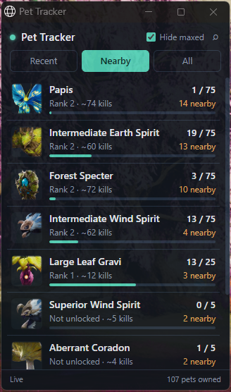

# AION 2 Pet Tracker

A small always-on-top overlay for AION 2 that shows your pet soul progress while you farm. It tells you which pet monsters are around you, how many souls each pet has (`19 / 75`), and roughly how many kills are left to the next rank.



There are plenty of DPS meters for AION 2. As far as I know, none of them track pets.

## Install

1. Install **[Npcap](https://npcap.com/#download)** with the default options. If you already have Wireshark or a DPS meter like A2Tools or NotMeter, you have it.
2. Download `PetTracker-Setup-x.y.z.exe` from [Releases](https://github.com/caiooncoding/aion-pet-tracker/releases/latest) and run it. It installs for your user only and doesn't need admin rights.
3. Start **Pet Tracker** *before* you log into your character. The game only sends your pet list during login.

**Updating:** when a new version is out, an **Update x.y.z** button shows up in the overlay's header. Click it and the app downloads the installer, updates itself and starts again. You can also just run a newer `PetTracker-Setup` over the old one. Either way there's no need to uninstall, and your pets, settings and window position are kept.

Windows SmartScreen may warn about an unknown publisher, because the installer isn't code-signed. Click **More info → Run anyway**.

**Requirements:** Windows 10/11 (64-bit), Npcap, and Microsoft Edge or Google Chrome for the overlay window. Edge ships with Windows. Run the game in **windowed** or **borderless** mode so the overlay can sit on top of it.

## Using it

The top card shows the pet you're farming: the last pet you got a soul for, or else the closest unfinished pet nearby. It has souls, rank and an estimate of kills left. Below it:

| Tab | Shows |
|---|---|
| **Nearby** | Pets whose monsters are around you right now, with how many are close |
| **Recent** | Pets you just got souls for this session |
| **All** | Your whole collection, closest to the next rank first |
| **Map** | The zone map with the pet monsters around you as dots, one color per pet (grey = maxed), and a legend with souls and counts |

- **Drag** the header to move the overlay, and use the bottom-right corner to resize it. It remembers both.
- **Lock** (padlock button) makes the overlay click-through so it never gets in the way in game. The lock button itself stays clickable, and **Ctrl+Shift+P** toggles it from anywhere.
- **Settings** (sliders button): opacity, hide maxed pets, and compact mode (only the top card).
- **Map** works in Verteron, Altgard, Chaotic Lower Reshanta, Ishalgen and Poeta. The app works out the zone from the monsters it sees. Verteron is lined up out of the box; the other zones line up on their own after a minute of farming there.
- **~N kills** is an estimate. It starts at 1 soul per kill and adjusts to the drop rate you actually get.

Pets need 5 souls to unlock, 25 more for rank 2 and 75 more for rank 3 (max on global).

## How it works

The game client doesn't write a chat log, so like the DPS meters, Pet Tracker reads the game's network traffic through Npcap. It doesn't inject anything into the game, read its memory, or send anything back to it. It only listens.

The useful messages from the game server:

| Opcode | Meaning |
|---|---|
| `0x0090` | Full pet list at login: every pet's id, rank and souls |
| `0x0D90` | Soul gained: pet id + amount |
| `0x4036` / `0x4136` | Monster spawned / state, with its monster id |
| `0x008D` | Monster HP; 0 means it died |
| `0xA6FF` | Sent right after a monster *you* killed dies |

Pet ids are matched to names with a built-in table. Monster names are matched to pets through the wiki data, which is how the Nearby tab works. The pet list comes from wikily.gg and is refreshed once a week. A copy is built in, so the app also works offline.

Everything stays on your PC. The overlay is a local page on `127.0.0.1:7319`. The only outside requests are the weekly pet list download from wikily.gg, the pet icons, and an update check against this repo's GitHub releases every few hours (set `PT_NO_UPDATE=1` to turn it off).

Your progress and logs are kept in `%APPDATA%\PetTracker`. If something breaks, `pettracker.log` in that folder is the first thing to look at.

## Use at your own risk

Packet-reading tools are a grey area in most MMO terms of service. NCSOFT has publicly warned DPS-meter makers about recording and sharing other players' data. Pet Tracker only looks at your own pets and kills and doesn't share anything. Even so, a third-party tool always carries some risk to your account.

Game patches can change the network messages. If the tracker suddenly shows nothing after a patch, that's probably why. Open an issue.

## Building from source

Needs Go 1.24+, [NSIS 3](https://nsis.sourceforge.io/) and `rsrc`. The build runs fine on Linux and cross-compiles the Windows binaries.

```sh
go install github.com/akavel/rsrc@v0.10.2
scripts/build.sh              # version from VERSION -> dist/PetTracker.exe + dist/PetTracker-Setup-<version>.exe
go test ./...
```

For testing without the game, you can replay a Wireshark capture:

```sh
go run ./cmd/pettracker -pcap capture.pcapng            # prints what it found
go run ./cmd/pettracker -pcap capture.pcapng -serve     # and serves the overlay on :7319
```

`tools/` has the Python scripts used to work out the protocol (`decode_stream.py`, `pcap_to_stream.py`, `kills.py`, and others).

### Layout

```
cmd/pettracker/   the app (Go, standard library only)
  proto.go          frame decoding + LZ4
  tcp.go            TCP reassembly, finds the game connection
  capture_windows.go Npcap (wpcap.dll) binding, no cgo
  game.go           pet / monster state
  data.go           pet + monster data
  zonemap.go        Map tab: zone detection, map calibration, tiles
  update.go         update check + one-click update
  web.go, assets/overlay.html   the overlay page
  overlay_windows.go  overlay window, kept on top
installer/        NSIS script, icon, manifest
scripts/build.sh  build everything
tools/            protocol research scripts
```

## Credits

- Protocol framing worked out with the help of [Aion2Flow](https://github.com/cloris-chan/Aion2Flow) (GPL-3.0), an open-source AION 2 combat meter. No code is copied; the monster names in `assets/npcs.json.gz` come from its resource pack.
- Pet monster lists and icons: [wikily.gg](https://wikily.gg/aion-2/pets).
- Zone maps and monster spawn points: [wikily.gg](https://wikily.gg/aion-2/interactive-map) (game art © NCSOFT). See `assets/README.md`.
- Pet id ↔ name table: [aion2wiki.date](https://aion2wiki.date/pets).

Not affiliated with or endorsed by NCSOFT. AION is a trademark of NCSOFT Corporation.


## Releasing

Bump the number in `VERSION` and push to `master`. CI builds, tests and publishes `vX.Y.Z` with the installer attached.

## License

[MIT](LICENSE)
