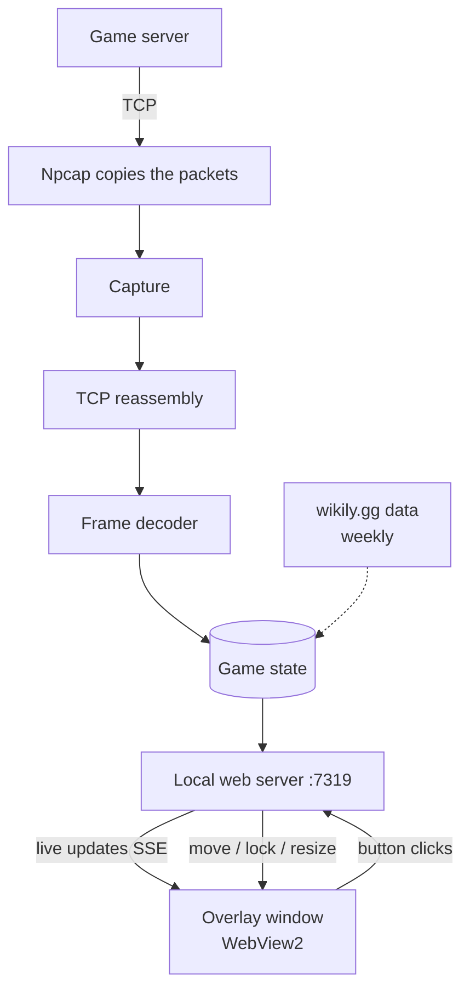
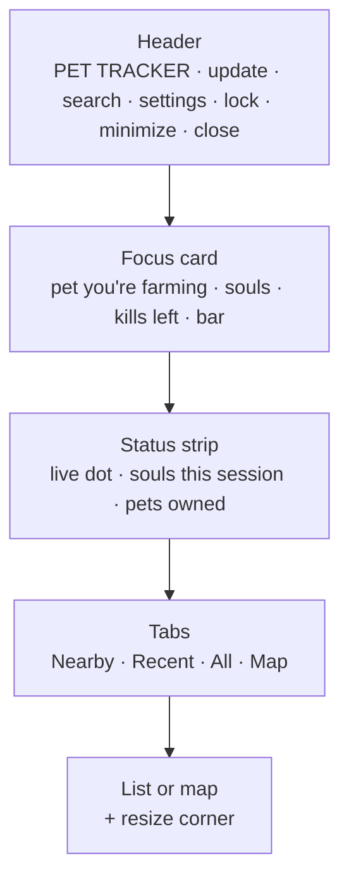
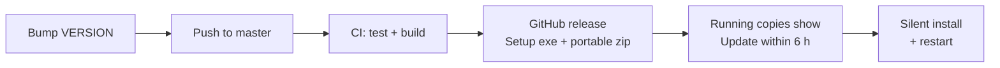

# Pet Tracker: how it works

## The short version

One Windows exe written in Go. It listens to the game's network traffic, keeps track of your pets, and shows the result in a small web page that sits on top of the game.

## Stack

| What | Used |
|---|---|
| Language | Go 1.24, standard library only, plus one dependency (go-webview2) |
| Packet capture | Npcap (`wpcap.dll`), called through syscall, no cgo |
| UI | One HTML file with vanilla JS and CSS, no framework, no build step |
| Window | WebView2 inside our own borderless Win32 window. The fallback is an Edge `--app` window |
| Installer | NSIS, per user, no admin needed |
| CI / releases | GitHub Actions: bump `VERSION`, push to master, and the release goes out |

The whole thing cross-compiles from Linux, so you don't need a Windows box to build it.

## Backend, file by file (`cmd/pettracker/`)

| File | Job |
|---|---|
| `capture_windows.go` | Opens every network adapter through Npcap and passes on each TCP packet |
| `tcp.go` | Puts TCP streams back in order and finds the game connection by looking for known opcodes |
| `proto.go` | Splits the stream into game frames: varint length, then a 2-byte opcode. Also unpacks LZ4-compressed frames |
| `game.go` | **The state.** Handles each opcode and keeps pets, souls, monsters around you and kills. `View()` builds what the UI shows |
| `data.go` | Built-in data: pet ids to names, pets to monsters, monster names. Refreshes from wikily.gg once a week |
| `zonemap.go` | Map tab: guesses the zone from the monsters it sees, lines up game coordinates with the map image, serves the map tiles |
| `settings.go` | Saved settings plus the window commands the page can send (move, resize, lock, close) |
| `web.go` | HTTP server on `127.0.0.1:7319`: the page, a JSON view, and an SSE live stream |
| `update.go` | Checks GitHub for a new release. The Update button downloads the installer and runs it silently |
| `webview_windows.go` | Our own overlay window with WebView2 inside |
| `overlay_windows.go` | Window control: always on top, opacity, click-through lock, drag/resize, Ctrl+Shift+P, the old Edge fallback |
| `taskbar_windows.go` | Gives the overlay its own taskbar icon |
| `replay.go`, `pcapfile.go` | Replay a saved capture for testing without the game |

### Opcodes it reads

| Opcode | Meaning |
|---|---|
| `0x0090` | Pet list at login (every pet's level and souls) |
| `0x0D90` | Soul gained |
| `0x4036` / `0x4136` | Monster spawned (id and position) |
| `0x008D` | Monster HP (0 = dead) |
| `0xA6FF` | You got the kill |
| `0x1A37`–`0x1C37` | Monster moved |

## Patterns (the few that matter)

- **Pipeline.** capture → reassemble → decode → state. Each step only knows about the next one.
- **One state object with a mutex.** Everything writes into `State`, and the UI only reads a snapshot from `View()`.
- **Observer.** The state notifies the open UI streams whenever something changes. The UI also polls every 2 s as a safety net.
- **Platform split by file.** `*_windows.go` holds the real code and `platform_other.go` holds stubs, so tests run on Linux.
- **Embedded assets.** The HTML, icons and data are compiled into the exe. The map images sit in a `maps/` folder next to it.
- **Graceful fallback.** If WebView2 fails, it uses an Edge window. If wikily is down, it uses the built-in data. If the update fails, it shows a retry button.

## UI (`assets/overlay.html`)

One page laid out top to bottom:

- The page gets the whole view as JSON over SSE (`/api/events`) and re-renders. There's no state of its own in the page, apart from map zoom.
- Buttons send POSTs to `/api/settings` and `/api/window?do=...`. The Go side moves the real window.
- **Map tab:** 512 px map image tiles, with dots placed using the calibrated transform. One colour per pet, grey for maxed.
- **Lock:** the window becomes click-through. The page reports where the lock button is, and Go makes just that spot clickable again.

## Data on disk

| Where | What |
|---|---|
| `%LOCALAPPDATA%\Programs\PetTracker` | exe, maps, uninstaller |
| `%APPDATA%\PetTracker` | `state.json` (pets, settings, map calibration), `pettracker.log`, pet data cache, WebView2 profile |

The installer only touches the first folder, so updates keep your progress.

## Release flow

